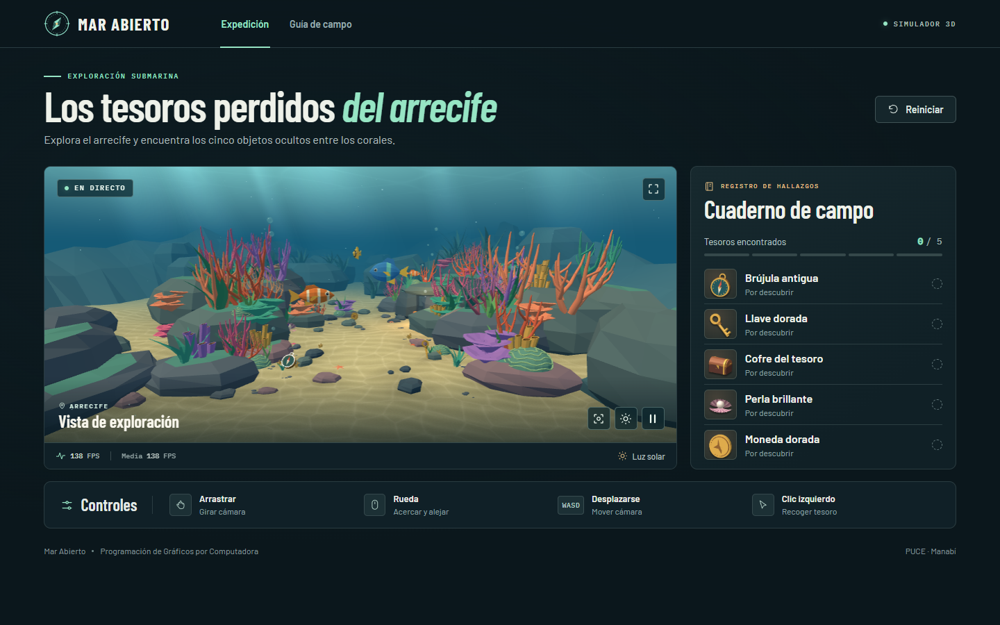

# Los tesoros perdidos del arrecife

Una expedición submarina en 3D para encontrar una brújula antigua, una llave dorada, un cofre, una perla y una moneda. Gira alrededor de las rocas, acércate a las colonias de coral y pulsa en la parte visible de cada pieza para anotarla en tu cuaderno de campo.



| Proyecto académico | |
| --- | --- |
| Asignatura | Programación de Gráficos por Computadora |
| Universidad | Pontificia Universidad Católica del Ecuador, sede Manabí |
| Integrantes | John Steven Lopez Velez y Samuel Andres Vega Mendoza |
| Docente | Ing. Victor Hugo Alonzo Palacios |

## Ejecutar en Windows

Abre PowerShell en la carpeta que contiene este README. La primera instalación necesita conexión para descargar dependencias. Después, los modelos, las texturas, las miniaturas y las fuentes se cargan desde el equipo.

### Escritorio · Python, pygame y PyOpenGL

Usa Python 3.12 de 64 bits y un controlador con OpenGL 3.3 Core o superior. El entorno virtual queda dentro del proyecto.

```powershell
py -3.12 -m venv .venv
.\.venv\Scripts\python.exe -m pip install -r pyopengl/requirements.txt
.\.venv\Scripts\python.exe pyopengl/main.py
```

Si tu instalación expone `python`, puedes usar `python -m venv .venv` después de comprobar la versión con `python --version`. La ventana admite cambios de tamaño. Para fijar su tamaño inicial, añade por ejemplo `--width 1280 --height 760`.

### Navegador · JavaScript, Three.js y Vite

Usa Node.js 22.12 o superior, npm y un navegador con WebGL 2. Desde la raíz del proyecto ejecuta lo siguiente.

```powershell
cd threejs
npm.cmd install
npm.cmd run dev
```

Abre la dirección local que imprime Vite. Para detener el servidor usa **Ctrl+C** en esa terminal. En macOS o Linux usa `npm` en lugar de `npm.cmd`. También puedes usar `npm ci` para instalar exactamente las versiones del archivo de bloqueo.

## Controles

| Entrada | Acción |
| --- | --- |
| Arrastrar con el botón izquierdo | Girar alrededor del punto de interés |
| Rueda | Acercar y alejar |
| W / S | Avanzar o retroceder respecto de la vista |
| A / D | Desplazarse lateralmente |
| Clic izquierdo | Recoger un tesoro visible |
| P | Pausar o reanudar peces, plantas, burbujas y efectos del agua |
| L | Alternar entre luz solar y lunar |
| R | Restablecer cámara, animaciones, tesoros, iluminación y media de FPS |
| Esc | Salir de la aplicación de escritorio. En la web, abrir o cerrar la guía o salir del visor ampliado |

En una pantalla táctil, gira con un dedo, desplázate o cambia el zoom con dos dedos y toca para recoger. El visor web también tiene botones para centrar la cámara y ampliar la escena. Cada hallazgo gira y crece durante 0,85 segundos. El quinto completa la expedición.

## Organización

| Ruta | Contenido |
| --- | --- |
| `shared/settings.json` | Cámara, controles, luces, animaciones y catálogo de tesoros |
| `shared/reef.json` | Mallas, normales, índices, materiales, posiciones y grupos de la escena común |
| `shared/*.mjs` | Generación determinista del arrecife y de sus modelos originales |
| `assets/` | Textura repetible de arena y miniaturas de los modelos |
| `pyopengl/` | Aplicación SDL/pygame, matrices, shaders GLSL y pruebas |
| `threejs/` | Aplicación WebGL, cuaderno HTML/CSS, controles y pruebas |
| `documentacion/` | Capturas, protocolo de medición y guía para el informe |

Los recursos generados están incluidos. Para modificar la geometría, edita sus generadores y ejecuta `node shared/generar.mjs` desde la raíz. Si cambias la forma o los materiales de los tesoros, `assets/miniaturas.py` regenera sus ilustraciones con NumPy y Pillow. Pillow es opcional para el desarrollo de las miniaturas.

## Verificar una entrega

Desde la raíz, con las dependencias instaladas, ejecuta lo siguiente.

```powershell
.\.venv\Scripts\python.exe -m compileall -q pyopengl
.\.venv\Scripts\python.exe -m unittest discover -s pyopengl -p "test_*.py"
.\.venv\Scripts\python.exe pyopengl/main.py --smoke
npm.cmd --prefix threejs test
npm.cmd --prefix threejs run build
```

La prueba `--smoke` crea una ventana OpenGL oculta, comprueba píxeles renderizados y utiliza la ruta de selección de la partida. Para guardar el primer fotograma añade `--capture arrecife.png`. Las pruebas web lanzan rayos contra las mallas reales. La compilación produce `threejs/dist/`; para inspeccionarla, ejecuta `npm.cmd --prefix threejs run preview`.

El protocolo incluye la comparación de FPS, las diferencias entre motores y un guion para defender el proyecto. [Comparativa técnica y guía del informe](documentacion/comparativa.md)

## Solución de problemas

| Síntoma | Qué comprobar |
| --- | --- |
| Windows no reconoce `py` o abre Microsoft Store | Comprueba el ejecutable de Python 3.12 con `python --version`. Usa su ruta para crear el entorno virtual. |
| `ModuleNotFoundError` al iniciar | Repite la instalación y el arranque con el mismo `.venv\Scripts\python.exe`. |
| PowerShell bloquea `npm.ps1` o la activación | Los comandos de esta guía invocan `npm.cmd` y el ejecutable del entorno virtual directamente. |
| Falla la creación del contexto GL o WebGL | Comprueba el controlador de la GPU y la aceleración gráfica del navegador. Prueba desde una sesión de escritorio con acceso a GPU. |
| Faltan modelos o texturas | Comprueba que la descarga conserve juntas las carpetas `shared`, `assets`, `pyopengl` y `threejs`. Abre la web mediante la dirección de Vite. |
| El clic no recoge una pieza | Gira o acércate hasta ver un fragmento del tesoro. El objeto sólido más cercano tapa lo que queda detrás. Suelta el botón sin arrastrar. |
| La media parece limitada por el monitor | Revisa el refresco, la sincronización vertical y el tamaño del búfer. Usa el protocolo de comparación para registrar las condiciones. |

Los modelos, la arena, los iconos y las miniaturas se construyeron para este proyecto. Las fuentes Barlow, Barlow Condensed e IBM Plex Mono se distribuyen bajo SIL OFL. Los avisos de las fuentes y de Three.js acompañan la versión web en `threejs/public/licencias/`.
