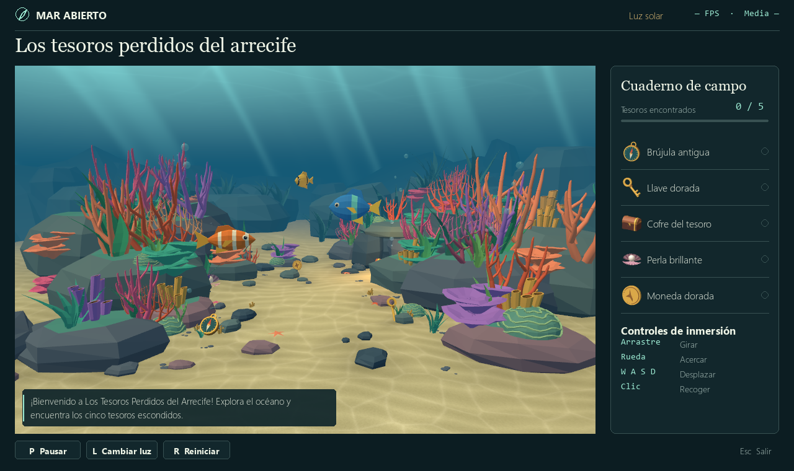

# Comparativa técnica y guía del informe

Las dos aplicaciones leen el mismo arrecife. Esto permite atribuir diferencias observables al motor, a los materiales y al método de interacción manteniendo fijas las piezas, su posición y el recorrido de los peces.

## Resultado observado en Windows

El 19 de noviembre de 2026 se ejecutó una muestra final de 30 segundos por motor, por separado, en un AMD Ryzen 7 9700X con NVIDIA GeForce RTX 5070 y controlador 617.42. Las dos pruebas usaron la cámara inicial, luz solar, cuatro peces en movimiento, las cinco piezas pendientes y un búfer 3D de 936 × 594 píxeles. Se descartaron los primeros cinco segundos de cada ejecución.

| Ejecución | Cuadros | Tiempo medido | FPS medios |
| --- | ---: | ---: | ---: |
| Python 3.12.14, pygame 2.6.1, PyOpenGL 3.1.9 y OpenGL 3.3 | 1936 | 30,007 s | **64,52** |
| Three.js 0.180.0, Chrome 157.0.8103.79, WebGL 2 sobre ANGLE/D3D11 | 6000 | 30,0001 s | **200,00** |

La prueba nativa utilizó una ventana SDL oculta y pidió sincronización vertical con un tope adicional de 144 FPS. Chrome se ejecutó sin ventana visible y presentó aproximadamente 200 cuadros por segundo. La cadencia disponible, la composición de la interfaz y el trabajo de cada motor intervienen en esas cifras. Una sola corrida por motor describe esta ejecución concreta. Para generalizar o atribuir diferencias al rendimiento de la GPU hacen falta repeticiones y mediciones de tiempo de GPU.

## Qué comparar

| Aspecto | PyOpenGL y pygame | Three.js y Vite |
| --- | --- | --- |
| Geometría y cámara | NumPy compone las matrices de modelo, vista y proyección. Un VAO describe los atributos del VBO y un búfer de índices define los triángulos. | Cada malla usa `BufferGeometry`. Una jerarquía de `Group` y `Mesh` aplica las transformaciones, y `PerspectiveCamera` calcula la proyección. |
| Selección | En el clic se renderiza el ID de cada tesoro y el valor cero para los sólidos restantes. La prueba de profundidad resuelve qué fragmento se ve. Se lee un píxel. | `Raycaster` lanza un rayo desde la cámara por el puntero. La primera intersección con geometría sólida visible decide el resultado. |
| Dificultad de implementación | Hay que mantener formatos de vértices, ubicaciones de uniformes, shaders, orden de transparencias y coordenadas de la ventana. | La biblioteca resuelve esas operaciones habituales. Hay que sincronizar tamaños CSS y de dibujo, eventos del puntero y estado de los diálogos. |
| Material e iluminación | El shader combina iluminación ambiental, difusa y especular, atenuación de la luz puntual, textura sRGB y niebla. | `MeshStandardMaterial` utiliza rugosidad y metalicidad. Luces ambiental, direccional y puntual iluminan la misma geometría. |
| Diferencias gráficas | El fondo y los haces se calculan en un triángulo de pantalla. El shader de las superficies añade un reflejo ondulante. | Una bóveda, haces translúcidos y partículas suspendidas refuerzan la profundidad. Las siluetas y la arena proceden de los mismos recursos que en escritorio. |
| Interacción | Ratón y teclado dentro de una ventana SDL. El cuaderno se dibuja con pygame y se compone como textura. | Ratón, teclado y gestos táctiles. El cuaderno HTML se adapta al ancho, y el visor puede ampliarse a pantalla completa. |
| Portabilidad | Requiere un intérprete compatible, los paquetes nativos y un controlador OpenGL 3.3 Core. La ejecución se verificó en Windows. | El navegador necesita WebGL 2. Node.js y npm sirven para desarrollo y compilación. La carpeta `dist` se puede servir desde un servidor HTTP local. |

La dificultad indicada describe operaciones que se programaron en esta entrega. Para evaluar la facilidad **de uso**, pide a cada participante que encuentre un tesoro parcialmente oculto, cambie la luz y reinicie en ambas versiones. Alterna el orden y registra tiempo, clics fallidos y si necesitó ayuda. El conocimiento de las posiciones en la segunda partida puede acortar los tiempos.

Como referencia del volumen de código, escritorio tiene **834 líneas no vacías** de Python y GLSL de ejecución. La web tiene **964** entre JS, CSS y HTML. El recuento incluye comentarios y excluye pruebas, generadores, configuración, recursos entregados y dependencias. Los cuatro generadores compartidos suman otras **682 líneas**. La escena resultante contiene **69 mallas, 119 nodos y 127 768 triángulos** al contar las instancias de los nodos una vez. Estas cifras sirven para distinguir el trabajo del motor del trabajo común de modelado.

## Protocolo de FPS

1. Registra CPU, GPU, sistema, controlador, versión de Python, navegador y frecuencia de pantalla. Usa el mismo modo de energía y cierra otras cargas gráficas.
2. Ejecuta las versiones por separado. Conserva la vista inicial, luz solar, animaciones activas y cinco piezas pendientes. Ambos modos automáticos usan cinco segundos de calentamiento antes de contar cuadros.
3. Para escritorio, desde la raíz ejecuta el comando siguiente. Con la ventana predeterminada de 1280 × 760 el área 3D es de 936 × 594. El programa usa una ventana oculta y escribe en la terminal la resolución, los cuadros, la duración y la media.

   ```powershell
   .\.venv\Scripts\python.exe pyopengl/main.py --benchmark 30
   ```

4. Para web, compila y sirve la entrega. Abre la dirección local que imprime Vite con `/?benchmark=30` al final. Por ejemplo, si el puerto es 4173, abre `http://localhost:4173/?benchmark=30`. El búfer de dibujo es de 936 × 594 con relación de píxeles 1. Si la pestaña se oculta, el calentamiento empieza de nuevo.

   ```powershell
   npm.cmd --prefix threejs run build
   npm.cmd --prefix threejs run preview
   ```

5. Al terminar, el visor web muestra la media. El resultado detallado queda en la consola como `[Medición]` y se puede recuperar ejecutando `JSON.parse(document.querySelector('#reef').dataset.benchmarkResult)`. Recarga para repetir. Haz al menos tres corridas por motor para el informe y presenta la mediana y el intervalo observado.
6. Calcula FPS como **cuadros / segundos transcurridos**. Se mide la cadencia de la aplicación completa incluyendo actualización, renderizado y presentación. El navegador programa los cuadros con `requestAnimationFrame`. Escritorio solicita vsync y aplica un tope de 144 FPS. Registra los límites de presentación al interpretar la medición.

Para una comparación interactiva adicional, pulsa **R** después del calentamiento, usa el mismo recorrido de cámara y anota la **media** del HUD tras un intervalo cronometrado. Indica la resolución física del visor y mantenlo visible. En el modo web normal el factor de píxeles puede llegar a 1,5. Para convertir FPS a tiempo medio por cuadro usa **1000 / FPS** milisegundos.

## Verificación funcional

- La prueba gráfica de escritorio dibuja fotogramas, lee el búfer, comprueba movimiento y pausa, cambia las luces, recoge las cinco piezas e intenta recoger una pieza detrás de un sólido.
- En otra ejecución se enviaron eventos de ratón y teclado a la cola SDL de la aplicación de escritorio. El bucle de juego respondió al arrastre, los cinco clics, la pausa, el cambio de luz, el reinicio y la salida mediante Esc.
- Las pruebas JavaScript comprueban la oclusión y buscan rayos válidos en las mallas entregadas. También verifican límites de cámara, descubrimiento, victoria, reinicio y cálculo de FPS.
- La prueba de integración en Chrome recorrió la interfaz de la compilación de producción con eventos de ratón y teclado. Se comprobó el progreso de 0/5 a 5/5, la victoria, el reinicio, el modo lunar, la pausa, el centrado de cámara y la ampliación del visor.
- La comprobación de diseño a 390 píxeles de ancho confirmó que el cuaderno y los controles caben sin desplazamiento horizontal. La validación de escritorio y navegador se hizo en Windows.



## Preparar la exposición

1. **Pregunta y alcance.** Explica cómo la oclusión transforma una escena de cinco objetos fijos en una búsqueda que requiere cambiar de punto de vista.
2. **Construcción.** Enseña el perfil de anillos de un pez o una esponja en `shared/`. Relaciona sus vértices, normales e índices con la silueta y el sombreado. Identifica las coordenadas UV que repiten la textura de arena.
3. **Transformaciones.** Pausa y reanuda la escena. Explica la traslación elíptica y la orientación tangente de un pez. Compara el crecimiento de una burbuja con la rotación y el escalado transitorios de un hallazgo.
4. **Luz y visibilidad.** Alterna entre sol y luna junto a la cueva. Señala el relleno ambiental, las caras orientadas al sol y el alcance localizado de la luz puntual.
5. **Selección y estado.** Intenta pulsar un tesoro oculto detrás de una roca, cambia de ángulo y recógelo. Contrasta la lectura del píxel con el cruce rayo-triángulo. Explica por qué registrar el ID una sola vez conserva el contador.
6. **Resultados.** Presenta capturas equivalentes y una tabla de corridas. Distingue los resultados medidos de las pruebas de usabilidad que aún queden por hacer. Concluye qué parte del trabajo facilita cada tecnología.

Para fundamentar la explicación de la selección web y del flujo de compilación, consulta la documentación de los proyectos. [Three.js Raycaster](https://threejs.org/docs/#api/en/core/Raycaster) · [Guía de Vite](https://vite.dev/guide/)
